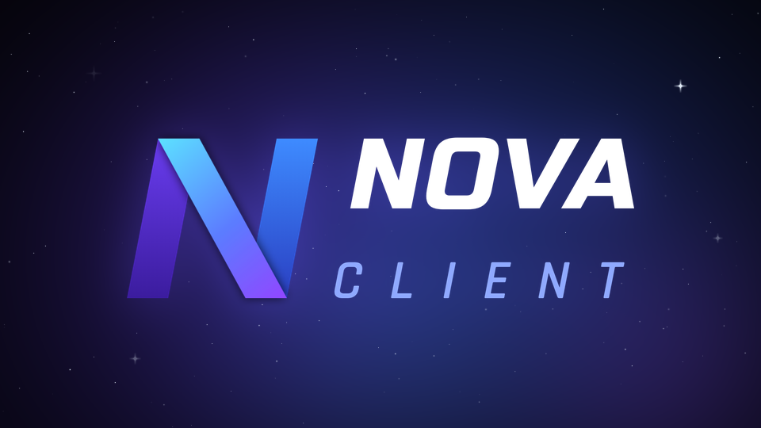

<p align="center">
  
</p>

<p align="center">
  <b>Free and open-source Fabric client for Minecraft 26.3 and 1.21.11</b><br>
  Beta 0.100 · GPL-3.0 · <a href="https://discord.gg/nova-client">Discord</a>
</p>

---

**English** · [Deutsch](#deutsch)

## What is Nova?

Nova is a utility client for Minecraft (Fabric) with its own clean, round GUI. All categories sit side by side, almost
every module has a live preview and its own settings, and the world stays visible behind the menu.

- **100+ modules** in Combat, Misc, Donut, Base Finding, Render, Visuals and Nova
- **Hyper Tools**: swords become lightsabers in rarity colors, with changing swing moves and three inspect animations
  (default key: <kbd>G</kbd>)
- **Render & visuals**: ESPs, Xray, Sky VFX, Motion Blur, Glowing Outlines, Jump Circles, Kill Effects, Fireflies and more
- **HUD editor**, profiles, macros, hotkey list, custom fonts
- **Nova Assistant**: an offline helper that answers questions about the modules (English, German, Turkish)

Some modules (e.g. combat or Xray) are not allowed on every server. Check the server rules before you use them.

## Install

1. Install [Fabric Loader](https://fabricmc.net/use/) for Minecraft **26.3** or **1.21.11**.
2. Put [Fabric API](https://modrinth.com/mod/fabric-api) and `NovaClient-<version>.jar` into your `mods` folder.
3. Start Minecraft, then open the Nova menu with <kbd>Right Shift</kbd>.

Official releases update themselves. Versions you build yourself never update automatically.

## Build from source

You need JDK 25 or newer (it builds both Minecraft versions).

```bash
./gradlew build          # Windows: gradlew.bat build
```

The finished mods land in `build/libs`: `NovaClient-26.3.jar` and `NovaClient-1.21.11.jar`.
How the multi-version setup works (Stonecutter) is described in [VERSIONEN.md](VERSIONEN.md) (German).

## Credits

- Fonts: Geist, Inter, Roboto and others under the SIL Open Font License / Apache 2.0, see
  `src/main/resources/licenses/fonts` and `src/main/resources/assets/nova_client/font`
- Knives model "Shadow Daggers" by zFabby (CC BY 4.0), see `src/client/resources/assets/nova_client/knives/CREDITS.txt`

## License

Nova Client is free software under the [GNU General Public License v3.0](LICENSE) (GPL-3.0-only). You may use,
change and share it; changed versions must stay open source under the same license.

Nova Client is not affiliated with Mojang or Microsoft.

---

## Deutsch

Nova ist ein kostenloser Open-Source-Client für Minecraft (Fabric) mit eigener, runder Oberfläche: alle Kategorien
nebeneinander, Vorschau und Einstellungen für fast jedes Modul, die Welt bleibt hinter dem Menü sichtbar.

- **Über 100 Module** in Combat, Misc, Donut, Base Finding, Render, Visuals und Nova
- **Hyper Tools**: Schwerter werden zu Laserschwertern in Seltenheitsfarben, mit wechselnden Schlag-Moves und drei
  Inspect-Animationen (Standardtaste <kbd>G</kbd>)
- **HUD-Editor**, Profile, Makros, eigene Schriftarten und der Offline-Assistent **Nova AI**

Manche Module (z.B. Combat oder Xray) sind nicht auf jedem Server erlaubt – vorher die Serverregeln lesen.

**Installieren:** Fabric Loader für Minecraft 26.3 oder 1.21.11 installieren, Fabric API und `NovaClient-<version>.jar`
in den `mods`-Ordner legen. Das Nova-Menü öffnet sich mit <kbd>Rechte Umschalttaste</kbd>.

**Selbst bauen:** JDK 25 oder neuer, dann `gradlew.bat build` (Windows) bzw. `./gradlew build`. Die fertigen Jars liegen
in `build/libs`. Wie das Projekt mehrere Minecraft-Versionen baut, steht in [VERSIONEN.md](VERSIONEN.md).

Offizielle Versionen aktualisieren sich selbst, selbst gebaute nie.

**Lizenz:** GPL-3.0 – du darfst Nova benutzen, ändern und weitergeben; geänderte Versionen müssen unter derselben Lizenz
offen bleiben.
